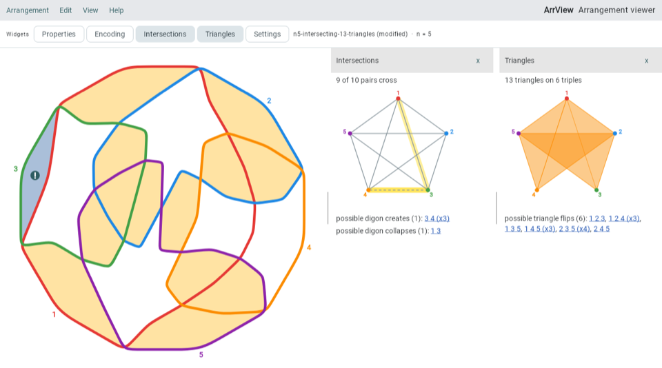
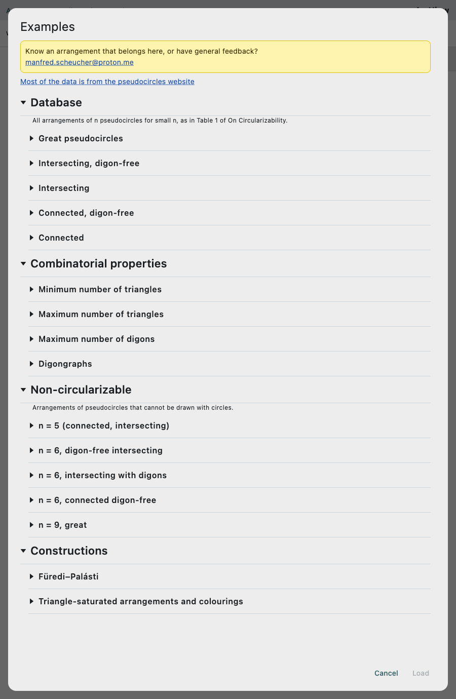
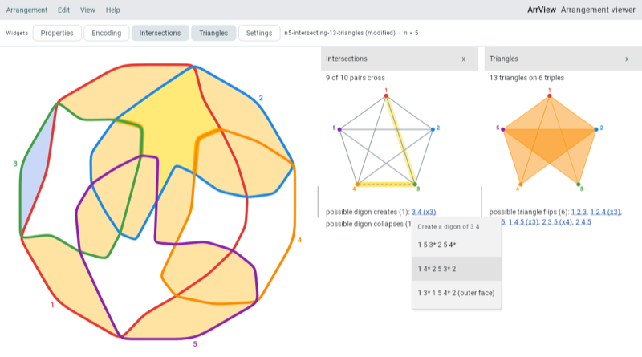
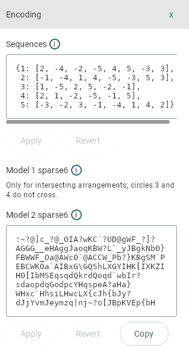
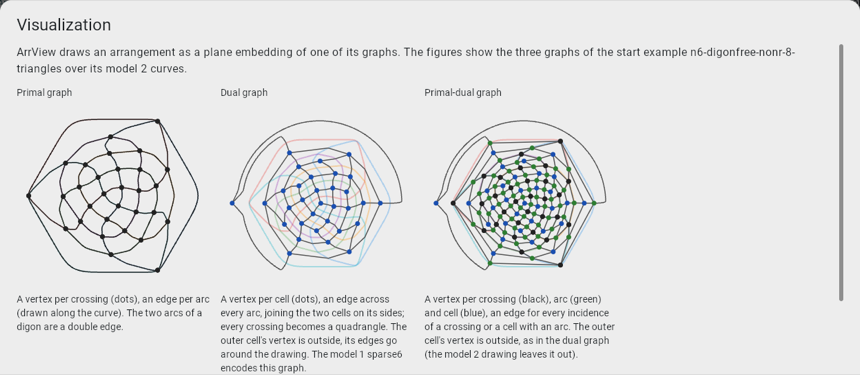

# ArrView user manual

ArrView is a viewer for arrangements of pseudocircles. You change an arrangement by flipping
triangles, collapsing and creating digons, and look at its combinatorial properties. It runs in the
browser (https://scheucher.dev/ArrView/) and as a desktop app; both work the same,
except where this manual says otherwise.

## What you can do

- Load examples by purpose: the database of small arrangements, minimum and maximum number of
  triangles, Füredi–Palásti, non-circularizable, triangle-saturated with coloured crossings,
  digongraphs, Krupp / NonKrupp / 3-Chain.
- Paste and open arrangements as JSON, intersection sequences or sparse6 (model 1 and model 2); save
  them as JSON or sequences; copy any of these forms.
- Browse files and example sets that hold several arrangements, one at a time.
- Flip a triangle, collapse a digon, create a digon; undo and redo.
- Choose the outer face of the drawing.
- See the numbers and classes of the arrangement: crossings, faces, p-vector, Krupp triples,
  intersecting, digon-free, pseudo great circles, cylindrical.
- See the intersection graph and the triangle hypergraph, and do the flips, collapses and creates
  from there.
- Edit the arrangement as text (sequences or sparse6) and apply it.
- Export a picture as SVG.
- Choose the drawing (model 2 or model 1), the colours and the line width; the settings are
  remembered.

## Basics

- An arrangement of pseudocircles is a set of closed curves where every two curves meet at most
  twice and cross at each meeting point. The curves need not be circles; only the combinatorics
  counts. ArrView shows connected arrangements (together the curves are connected).
- The curves cut the plane into faces. A face with 3 sides is a triangle (filled light orange), one
  with 2 sides a digon (filled light blue).
- Circles are numbered from 1, with the number next to the curve. The colour scheme gives each circle
  a colour (Standard repeats after 12).
- ArrView draws the arrangement as an iterated Tutte embedding of one of its graphs (see
  [Visualization](#visualization)). The drawing is computed in the background; until it is done,
  the previous one stays.
- The outer face is drawn around the rest. By default it is the face with the most symmetries, of
  those the largest (a larger outer face gives a rounder drawing).

## The screen

- Menu bar: Arrangement, Edit, View, Help. On narrow screens it scrolls sideways.
- Toolbar: the widget buttons, the arrows `<` `>` for files and example sets with several
  arrangements, and the status: the name (with "set i/n", and "(modified)" after an edit), n and the
  last message. Messages like "Flipped a triangle" or "Saved …" fade after 3 s; warnings like
  "the arrangement would fall apart" stay until the next message. When the row is full, the status
  moves to a line of its own.
- Canvas: the drawing.
- Widgets: Properties, Encoding, Intersections, Triangles and Settings, next to or below the canvas.
  At the first start Properties is open, and the start arrangement is the example
  n6-digonfree-nonr-8-triangles.

At the first start a Welcome dialog says what ArrView is for; Examples opens the examples, Start
closes it, "Don't show again" turns it off. Errors (a file or text that cannot be read) open an Error
dialog.

The web version needs WebGL. Without it, ArrView shows a note to turn on hardware acceleration in the
browser.

## Load arrangements

All of these are in the Arrangement menu.

**Examples...** lists the bundled arrangements as a tree: supergroups, their groups, then the sets.
Everything starts collapsed. An open supergroup or group starts with what it is.

- Database (all arrangements of n pseudocircles for small n, as in Table 1 of On Circularizability):
  Great pseudocircles (n = 3 to 8), Intersecting, digon-free (3 to 6), Intersecting (2 to 5),
  Connected, digon-free (3 to 5), Connected (3 to 5).
- Combinatorial properties: Minimum number of triangles, Maximum number of triangles, Maximum number
  of digons (n = 4 to 7), Digongraphs.
- Non-circularizable (cannot be drawn with circles): n = 5 (connected, intersecting); n = 6,
  digon-free intersecting; n = 6, intersecting with digons; n = 6, connected digon-free; n = 9, great.
- Constructions: Füredi–Palásti (great pseudocircle arrangements with 2n(n-3)/3 triangles),
  Triangle-saturated arrangements and colourings (every edge lies on exactly one triangle; in six of
  them the crossings are drawn in their colours).

The selected entry shows its description, n and the number of arrangements, then its links (website
pages and papers it comes from) and where the data is from. An entry with several arrangements has "(k)" after its name and a number field with `−` and
`+` to choose one ("1 of 4"; a number out of range disables Load). Load opens the whole set at the
chosen arrangement, so you can step through the others with `<` `>`. The dialog remembers its state
(open nodes, selection, scroll position) while the app runs; collapsing the supergroup or group of the
selected entry clears the selection. The yellow box has a mail address for sending interesting
arrangements or feedback (as in the Welcome and About dialogs).

**Import...** reads pasted text, one or more arrangements; the format is detected (see
[File formats](#file-formats)).

**Open file...** reads `.json`, `.txt`, `.enc`, `.mod1s6`, `.mod2s6` and `.s6`. On the web this uses
the browser's file picker, on the desktop a file chooser.

Loading is one undo step.

### Several arrangements

A file, a pasted text or an example set can hold several arrangements. Then one is shown at a time:
the toolbar shows the arrows `<` `>` with "i / n" between them, and the status says "set i/n";
PageUp/PageDown (or `,` and `.`) do the same. After loading, a dialog says how many arrangements were
loaded ("Don't show again" turns it off). Edits to an arrangement are kept when you switch to another
one; switching clears the undo history and goes back to the default outer face.

### Unsaved changes

If the arrangement changed since it was loaded or saved, Load (Examples), Import and Open file first
ask "Save changes?": Save JSON or Save text saves and goes on, Discard goes on without saving, Cancel
stops. On the desktop, closing the window (or Cmd+Q) asks the same. The browser does not ask when you
close the tab. An unapplied edit in the Encoding widget is never saved: if it is the only change, the
dialog offers just Discard and Cancel. Switching to another arrangement of the set asks this only for
such an edit.

## View and navigate

- Zoom with the mouse wheel (at the pointer), by pinching, with `+`/`-`, or View → Zoom in / Zoom out.
- Pan by dragging, or with two fingers.
- Fit: View → Fit, Home or `0`.
- Until you zoom or pan, the drawing fits again whenever the canvas changes size (window, widgets,
  dividers, layout). Fit, loading, Apply and switching arrangements fit again and turn this back on.
  Flips, collapses, creates, undo and redo do not refit.

## Change the arrangement

A click on a face does what can be done there:

| Face | Click |
|---|---|
| Triangle | flip it |
| Digon | collapse it: its two circles no longer cross there (refused if the arrangement would fall apart) |
| Face where two circles that do not cross both have a side | create a digon: one is pushed across the other, they cross twice |

The outer face works the same. The face under the mouse is shaded, and when a click does something
there, a "!" appears in it (for the outer face in a corner of the canvas).

If a face offers several digon creates, a click opens a menu: one entry per pair of circles, and a
pair with several ways opens a submenu (with only one pair, its ways are listed directly).

- In menus a face is written as the circles of its sides in order around it, for example `1 2 1 3`.
  For a digon create, a star marks the two sides that are pushed together, e.g. `1* 2 3* 2`.
- Pointing at a menu entry highlights its face in yellow (the outer face: its boundary, and the entry
  says "(outer face)") and the two sides of a digon create in orange.
- Several ways to create a digon of circles i and j are listed along circle i (the smaller number),
  in the order of its sequence, then along circle j.

**Face menu**: right-click a face (long press on touch screens, Ctrl+click on a Mac) for a menu headed
"Triangle", "Digon" or "Face with k sides": Flip triangle, Collapse digon, one "Create digon i j" per
pair (several ways: a submenu), and Make outer face, which draws that face around the rest. In
model 1 a digon cannot be the outer face. The desktop app has no long press.

Esc or a click outside closes a menu. Undo and Redo are in the Edit menu (Ctrl+Z, Ctrl+Shift+Z or
Ctrl+Y); they also take back Make outer face.

## Widgets and layout

The widget buttons in the toolbar and the View menu show and hide the widgets. The x in
a widget's title closes it.

- Wide window: each open widget is a column right of the canvas, in the order they were opened.
  Narrow window: they are stacked below the canvas. Layout auto/portrait/landscape in the View menu
  forces one of them; auto uses the width.
- All dividers between canvas and widgets can be dragged.
- At most "Max. widgets" are open (Settings widget, 1 to 5, default 2). Opening one more closes the
  one that was clicked least recently.
- If the window is too narrow for the canvas and the columns, the columns scroll sideways.

## Properties

The Properties widget shows the number of triangles (p3) and digons (p2) in large digits, then:

| Value | Meaning |
|---|---|
| n | number of circles |
| crossings | number of crossings |
| faces | number of faces |
| non-intersecting pairs | pairs of circles that do not cross |
| Krupp triples, NonKrupp triples | triples of pairwise crossing circles, by their type |
| p-vector | pk = number of faces with k sides, from p2 on |

Classes (yes or no): connected (always yes), intersecting (every two circles cross), digon-free (no
digon), pseudo great circles (intersecting and every triple a Krupp), cylindrical (two faces are
separated by every circle).

## Encoding

The Encoding widget shows the arrangement as text, in three forms, each with an (i) that says what it
encodes:

- Sequences: one line per circle (see [File formats](#file-formats)).
- Model 1 sparse6: only for intersecting arrangements; otherwise it names two circles that do not
  cross.
- Model 2 sparse6.

Edit one and press Apply, or Revert to go back. ArrView checks the conditions of Linhart and Ortner;
text that is not a valid arrangement opens an error dialog with the reason, and the edit stays. Apply
fits the view and is one undo step. An unapplied edit survives closing the widget. Copy puts a sparse6
string on the clipboard.

## Intersections

The intersection graph: the circles as vertices 1 to n on a circle, in their colours, and an edge
where two circles cross. Above it: "k of m pairs cross".

- A dashed edge: the two circles do not cross but can create a digon.
- A yellow stripe marks every pair that can create or collapse a digon, twice as strong if there are
  several ways. Click it to do it; with several ways a menu lists the faces (a face with several ways
  opens a submenu).
- Below the graph: "possible digon creates (k): 1 3 (x2), 2 4" and "possible digon collapses (k):
  ...". "(xm)" marks a pair with m ways. Each entry is a link: a click does what a click on the pair
  does, and pointing at it highlights the pair and its faces.

## Triangles

The triangle hypergraph: the same vertices, and a transparent triangle for every triple of circles
that bounds a triangle face, so overlapping triangles add up to darker areas. A triple with two or
more triangle faces is twice as strong. Above it: "k triangles on m triples".

- Click a triangle to flip it. Where several are under the mouse, a menu lists them with their faces
  (several triples: a submenu per triple).
- A triple is written ascending ("Flip a triangle of 1 2 3"); the menu entries are the faces in their
  own order around (e.g. `1 3 2`).
- Below it: "possible triangle flips (k): 1 2 3 (x2), 1 2 4, ..."; click an entry to flip, pointing
  at one highlights the triple and its faces.

## Settings

The Settings widget has three groups and one "Reset to defaults" for all of them.

- Display: Colour scheme (Standard, the default, a fixed list of 12 colours; rainbow and rainbow2,
  computed from n) and Line width (0.5 to 8 px, default 5). The scheme colours the curves, their
  numbers and the vertices of the graph views; both are used in Export SVG.
- Widgets: Max. widgets (default 2).
- Layout, for the drawing only: Visualization (model 2, the default, or model 1) and Max. iterations
  (at least 1, default 50). The (i) of Layout names the papers, the (i) of Visualization opens
  Help → Visualization.

### Visualization

- Model 2 (primal-dual graph, default): works for every connected arrangement and draws digons as
  regions.
- Model 1 (primal graph, legacy): only for intersecting arrangements of at least 3 circles; a
  digon's two circles touch at a point (blue dot).

Choosing model 1 asks first ("Model 1 is the legacy view…", OK or Cancel, "Don't show again"). If
the arrangement is not intersecting, it says so and stays on model 2. If any change (a collapse, a load, an
undo, ...) leads to an arrangement that is not intersecting while model 1 is chosen, a notice says
"Switching to model 2"; after OK it switches ("Don't show again" turns it off).

Help → Visualization shows the primal, dual and primal-dual graph of the start example and explains
the two models and the iteration.

Remembered for the next start (in the browser: per browser): the settings, the open widgets, the
divider positions, the layout and the "Don't show again" choices. Not
remembered: the arrangement and the Examples choices.

## Save and export

- **Save file...** (Arrangement menu): Save JSON or Save text writes all arrangements of the file or
  set, including your edits. The desktop app opens a file chooser and asks before it replaces an
  existing file; the web app downloads the file.
  After saving, the arrangement counts as saved.
- **Export...**: the shown arrangement as Sequences, Model 1 sparse6 (only if intersecting) or Model 2
  sparse6 in a text field, with Copy. This does not count as saving.
- **Export SVG...** saves the drawing as shown (colour scheme, line width, model, outer face, and the
  coloured crossings while the example is unedited). It always contains the whole drawing, not the
  current zoom. It does not count as saving either.

## Help

The Help menu has short pages (General, Visualization, Widgets, Formats, Keyboard shortcuts) and
About ArrView (links to GitHub and the pseudocircles website, literature, build, license texts).

## Keyboard and mouse

| Key or gesture | Action |
|---|---|
| Esc | close the open menu |
| Ctrl+O | open a file |
| Ctrl+S | save to a file |
| Ctrl+Z | undo |
| Ctrl+Shift+Z or Ctrl+Y | redo |
| + / - | zoom in / out |
| Home or 0 | fit |
| PageUp or , | previous arrangement of the file or set |
| PageDown or . | next arrangement of the file or set |
| Click a triangle | flip it |
| Click a digon | collapse it |
| Click another face | create a digon (several ways: a menu) |
| Right-click or long press on a face | its menu |
| Drag | pan |
| Wheel or pinch | zoom |
| Two fingers | pan and zoom |

On a Mac, Cmd works like Ctrl and Ctrl+click like a right-click. The keys do nothing while you type
in a field or a menu is open (except Esc, Ctrl+O and Ctrl+S).

## File formats

- Sequences: `{1: [2, -2, 3, -3], 2: [...], ...}`. List i gives the crossings along circle i in its
  orientation: +j where circle j crosses circle i from the right of i to its left, -j the other way.
  So +j in list i and -i in list j are the same crossing.
- Model 1 sparse6: the dual graph of an intersecting arrangement (a vertex per face, an edge per arc)
  in nauty's sparse6 format.
- Model 2 sparse6: the primal-dual graph (a vertex per crossing, arc and face) plus a leaf at every
  face vertex; works for every arrangement. The older encoding with marker hubs is read too.
- Both sparse6 forms are the formats of the pseudocircles website. ArrView may number the vertices
  differently, so its strings describe the same arrangements but need not equal the website's.
- JSON: `{"name": ..., "n": ..., "sequences": [[...], ...]}` (list i for circle i). `"mod1s6"` or
  `"mod2s6"` work instead of `"sequences"`. `"crossingColors"`, one colour word per entry of the
  sequences (`R`, `G`, `B`), colours the crossings. Other keys are ignored; a wrong `"n"` is an error.

Several arrangements: one sparse6 string per line, the sequences of several arrangements one after
the other, one JSON object per line, a JSON list of objects, or a set object
`{"name": ..., "arrangements": [{...}, ...]}` like the example files. For several arrangements, Save
JSON writes such a set object and Save text the sequences separated by an empty line.

Coloured crossings are drawn as coloured dots while the arrangement is as loaded (six of the
triangle-saturated examples); an edit removes them, undo brings them back.
